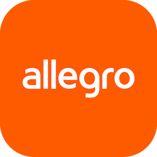

# Home Assistant Allegro integration



[![GitHub Release][releases-shield]][releases]
[![GitHub Activity][commits-shield]][commits]
[![License][license-shield]](LICENSE)
[![hacs][hacsbadge]][hacs]
[![Validate][validate-shield]][validate]
[![BuyMeCoffee][buymecoffeebadge]][buymecoffee]

Custom Home Assistant integration for [Allegro](https://allegro.pl) buyer accounts. It tracks orders, the shopping cart and seller messages, and can add offers to the cart, mark messages as read and download invoices sent in messages.

<p><font color="red"><strong>Breaking change (0.3.0):</strong> the pickup code, receiver phone number and QR code are no longer sensor attributes. Call <code>allegro.get_pickup_code</code> to read them.</font></p>

[](https://my.home-assistant.io/redirect/hacs_repository/?owner=Przemko92&repository=home-assistant-allegro&category=integration)
[](https://my.home-assistant.io/redirect/config_flow_start/?domain=allegro)

## Features

| Entity | Description |
| -- | -- |
| `sensor.allegro_in_progress` | Orders that are not delivered, returned, returned to the seller, or cancelled |
| `sensor.allegro_in_delivery` | Orders in `IN_DELIVERY` status |
| `sensor.allegro_in_transit` | Orders in `IN_TRANSIT` status |
| `sensor.allegro_waiting_for_pickup` | Orders in `AVAILABLE_FOR_PICKUP` status |
| `sensor.allegro_pickup_deadline` | Earliest deadline for collecting a waiting parcel (from Allegro's "Moje przesyłki"); every waiting parcel with its deadline is in the attributes |
| `sensor.allegro_cart` | Number of items in the shopping cart (details in attributes) |
| `sensor.allegro_waiting_in_another_pickup_point` | Parcels waiting in a pickup point other than your default one (only when a default pickup point is set) |
| `sensor.allegro_unread_messages` | Unread message threads. `details` lists the unread threads (`thread_id`, `seller`, `category`, `timestamp`, `preview`), `automatic` counts automatic shop messages |
| `sensor.allegro_invoice_messages` | Recent message threads in which a seller sent an invoice (details in attributes) |
| `todo.allegro_messages_to_read` | Unread message threads as a checklist: checking an item marks the thread as read |
| `button.allegro_mark_automatic_messages_as_read` | Marks unread automatic order messages as read |
| `button.allegro_mark_older_messages_as_read` | Marks unread automatic order messages as read when they are older than the configured days, or the seller has no order on its way (the same rule as the automatic option) |

Order details also carry `pickup_deadline`, `delivery_status` and `delivery_description` when Allegro lists the parcel under "Moje przesyłki".

Call `allegro.get_pickup_code` for the pickup code, receiver phone number and QR code. The service returns them only in its response, so the locker codes stay out of the state machine, the recorder and dashboards.

Order details include `pickup_point_name`, `pickup_point_description`, and `pickup_point_address` when Allegro returns a parcel locker or other pickup point. The address is the street, postal code, and city of that point.

When a **default pickup point** is set (see [Options](#options)), each order with a pickup point also gets `is_default_pickup_point`, and `sensor.allegro_waiting_in_another_pickup_point` counts parcels that wait somewhere else. The code is matched against the pickup point name, so `WAW01A` matches `Paczkomat WAW01A`.

## Messages and invoices

Unread messages are read from the Allegro message center (the most recent 100 threads are scanned). Every thread gets a category, based on its text:

| Category | Meaning |
| -- | -- |
| `order_status` | Automatic shop messages such as "Zamówienie jest realizowane", "Twoje zamówienie trafiło do realizacji", "W trakcie kompletowania" or "Dziękujemy za zakupy" |
| `invoice` | The seller sent an invoice or sales document ("w załączeniu przesyłamy fakturę", "Faktura VAT", a link to a sales document) |
| `other` | Everything else, including questions, returns, complaints and cancellations |

Only `order_status` messages are ever marked as read automatically. Invoices and `other` messages are never touched. The templates live in `ORDER_STATUS_PATTERNS` and `INVOICE_PATTERNS` in `custom_components/allegro/messages.py`; add a pattern there to teach the integration a new shop.

Allegro marks a thread as read when it is opened, so reading a message here means opening it through the API. This is also why `allegro.download_invoice` marks the thread as read.

## Services

### `allegro.add_to_cart`

Add an offer to the Allegro shopping cart. On success the cart sensor is refreshed.

| Parameter | Description |
| -- | -- |
| `item_id` | Allegro offer ID (required). This is `offerId` from the offer URL. |
| `quantity` | Pieces to add (default: 1) |
| `config_entry_id` | Account to use when multiple Allegro accounts are configured |

### `allegro.mark_message_read`

Mark one message thread as read. `thread_id` is shown in the attributes of `sensor.allegro_unread_messages`.

### `allegro.mark_messages_read`

Mark all unread threads of a category as read (up to 50 at a time). `category` is `order_status` (default), `invoice` or `other`. Returns `marked_read` when called with a response.

### `allegro.get_pickup_code`

Return the pickup code, receiver phone number and QR code for parcels already fetched by the integration. The values come back in the service response.

| Parameter | Description |
| -- | -- |
| `seller` | Seller login, as shown in the order sensor. Optional. Without `seller` and `waybill`, every open parcel that already has a code is returned |
| `waybill` | Tracking number of one parcel. Optional. Together with `seller`, both have to match |
| `config_entry_id` | Account to use when multiple Allegro accounts are configured |

A seller or waybill searches every cached order, including delivered ones. An unknown filter is an error.

```yaml
service: allegro.get_pickup_code
data:
  seller: "seller_login"
response_variable: pickup
```

`pickup.orders[0].pickup_code`, `receiver_phone_number` and `qr_code` are the secrets. Each row also has `seller`, `offers`, `waybills`, `order_id` and `pickup_point_name`.

### `allegro.download_invoice`

Download the attachments of a thread, for example an invoice PDF, and return the saved paths.

| Parameter | Description |
| -- | -- |
| `thread_id` | Thread to download from (required), see `sensor.allegro_invoice_messages` |
| `directory` | Where to save the files. Defaults to `allegro_invoices` in the Home Assistant configuration directory. Other directories must be listed in `allowlist_external_dirs` |

Attachments are not public links: they need your Allegro session, so they are downloaded by Home Assistant and not linked from a dashboard.

```yaml
service: allegro.download_invoice
data:
  thread_id: "AbCdEf0123456789AbCdEf0123456789AbC"
```

Example URL for `add_to_cart` (`item_id` is the bold `offerId`):

https://allegro.pl/produkt/kawa-ziarnista-100-arabica-west-caffee-brazil-monte-carmelo-1000-g-c7e0acba-5b98-4f99-969d-5e85580b95c6?offerId=**15070058532**

```yaml
service: allegro.add_to_cart
data:
  item_id: "15070058532"
  quantity: 1
```

## Installation

### HACS (recommended)

**Allegro buyer** is in the HACS default store.

1. Open HACS → **Integrations**
2. Use the button above to open this integration in HACS, or search for **Allegro buyer**
3. Download it
4. Restart Home Assistant
5. Optionally install the [Browser Companion](https://github.com/Przemko92/homeassistant-browser-companion) add-on (Home Assistant OS / Supervised) for in-UI sign-in
6. [Add the integration](https://my.home-assistant.io/redirect/config_flow_start/?domain=allegro): Settings → Devices & services → **Allegro buyer**
   - **Browser Companion** (optional): sign in at allegro.pl in the sidebar browser, then open **Moje Allegro → Zakupy → Kupione**. `QXLSESSID` is captured there
   - **Paste QXLSESSID**: browser dev tools (F12)

If you added `https://github.com/Przemko92/home-assistant-allegro` as a custom repository before it joined the default store, remove that custom repository in HACS. The installed files stay, and later updates come from the default store.

### Manual

1. Copy `custom_components/allegro` into `<config>/custom_components/allegro`
2. Restart Home Assistant
3. Add **Allegro buyer** from Settings → Devices & services

## Configuration is done in the UI

| Parameter | Description |
| -- | -- |
| `QXLSESSID` | Session cookie (pasted, or captured by optional Companion) |
| `user_name` | Optional value for multiple instances |

[Browser Companion](https://github.com/Przemko92/homeassistant-browser-companion) is optional. Without it, paste `QXLSESSID` from the browser.

### Options

Open the integration and choose **Configure**:

| Option | Description |
| -- | -- |
| Default pickup point | Code of your usual parcel locker, for example `WAW01A` |
| Mark automatic order messages as read | Off by default. When on, `order_status` messages are marked as read once the seller has no order on its way, or the message is older than the number of days below |
| Mark as read after (days) | Default: 7 |

Minimum Home Assistant version: **2026.8.0**.

To test against Supervisor + Companion, keep this repo next to `homeassistant-browser-companion`, rebuild that devcontainer, then run the task **Link Allegro custom component**. Details: `homeassistant-browser-companion/.devcontainer/README.md`.

## Debug logging

```yaml
logger:
  default: info
  logs:
    custom_components.allegro: debug
```

## Contributions are welcome!

If you want to contribute to this please read the [Contribution guidelines](CONTRIBUTING.md)

***

[home_assistant_allegro]: https://github.com/Przemko92/home-assistant-allegro

[buymecoffee]: https://www.buymeacoffee.com/przemko92
[buymecoffeebadge]: https://img.shields.io/badge/buy%20me%20a%20coffee-donate-yellow.svg?style=for-the-badge

[commits]: https://github.com/Przemko92/home-assistant-allegro/commits/main
[commits-shield]: https://img.shields.io/github/commit-activity/y/Przemko92/home-assistant-allegro.svg?style=for-the-badge

[hacs]: https://github.com/hacs/integration
[hacsbadge]: https://img.shields.io/badge/HACS-Default-41BDF5.svg?style=for-the-badge

[validate]: https://github.com/Przemko92/home-assistant-allegro/actions/workflows/validate.yml
[validate-shield]: https://github.com/Przemko92/home-assistant-allegro/actions/workflows/validate.yml/badge.svg

[releases]: https://github.com/Przemko92/home-assistant-allegro/releases
[releases-shield]: https://img.shields.io/github/release/Przemko92/home-assistant-allegro.svg?style=for-the-badge

[license-shield]: https://img.shields.io/github/license/Przemko92/home-assistant-allegro.svg?style=for-the-badge
